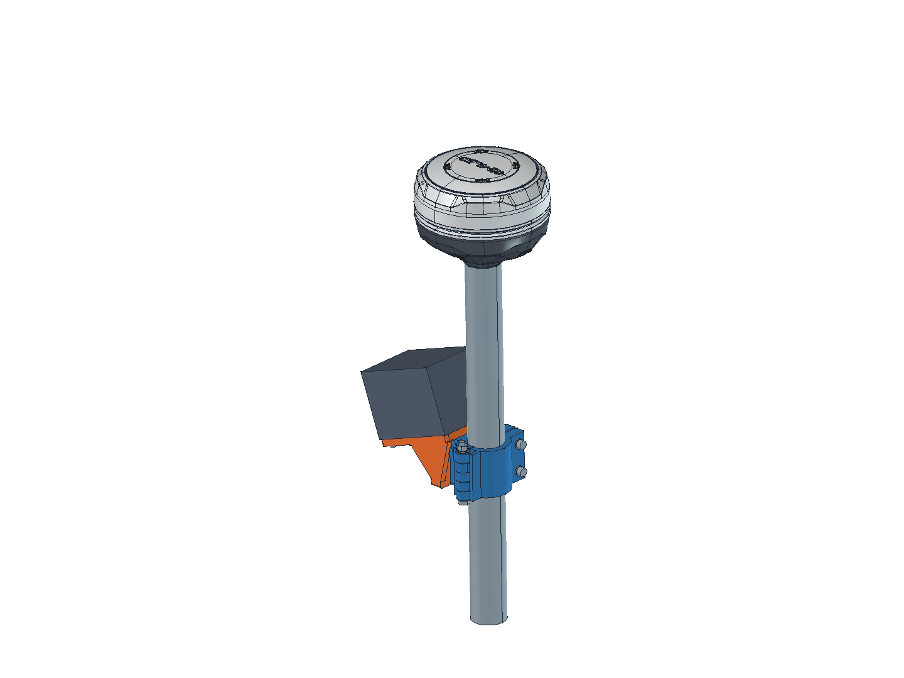
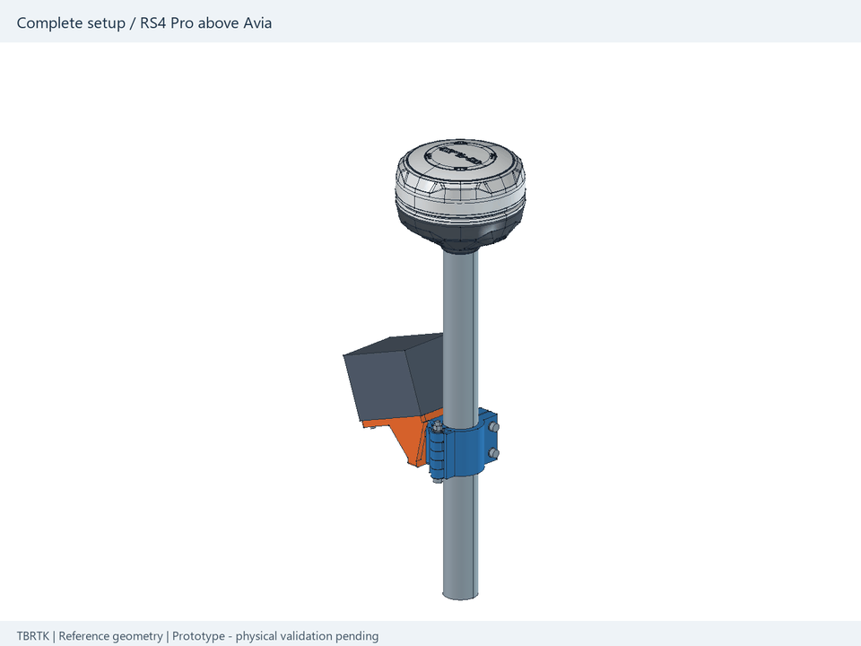
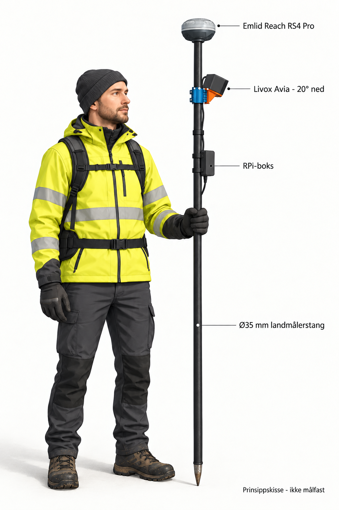

# Avia Ø35 Pole Mount - independent-reference edition

Public repository: [TBRTK/avia-pole-mount-public](https://github.com/TBRTK/avia-pole-mount-public).

TBRTK's survey-pole bracket for Livox Avia, with a **Reach RS4 Pro reference on the pole top**. This edition retains the original V1.0/V1.1/V1.2 bracket constructions and all three V1.2 print files. Livox manufacturer sensor, connector and FOV solids are replaced by independently built native parametric references.

**Prototype: physical validation pending.** No load rating or tightening torque is established. The receiver is carried by the pole; this change does not qualify the complete system.

## Companion software

[Livox Avia Raspberry Pi Logger](https://github.com/TBRTK/Livox-avia-rpi-logger) is the companion software repository for recording and monitoring on the Raspberry Pi. The planned web interface and API will be developed there alongside the logger; they are not included in the current logger v1.0. This repository contains the CAD models, print files and mounting documentation.

## First prototype release

[v1.2.0-prototype.1](https://github.com/TBRTK/avia-pole-mount-public/releases/tag/v1.2.0-prototype.1) provides one ZIP with all FreeCAD, STEP and STL files, documentation, animation and the complete-setup illustration. The English animation and illustration are also available as separate downloads, with SHA256 checksums. Start with the V1.2 FreeCAD file; V1.0/V1.1 are historical designs.

## Open and print

- Current FreeCAD: [V1.2 Public](cad/Avia_PoleMount_35mm_V1.2_Public.FCStd). Historical designs: [V1.0 Public](cad/Avia_PoleMount_35mm_V1.0_Public.FCStd), [V1.1 Public](cad/Avia_PoleMount_35mm_V1.1_Public.FCStd).
- [Three unchanged V1.2 STLs](print/v1.2/README.md), [own-part STEP exports](cad/step/v1.2). Units: mm; assembly coordinates retained.
- [Assembly](docs/ASSEMBLY.md), [hardware](docs/HARDWARE.md), [printing](docs/PRINTING.md), [limitations](docs/LIMITATIONS.md).

Open in FreeCAD 1.1.4 or compatible and recompute. `Parameters` retains the bracket controls: 35 mm pole, 20° sensor tilt and hinge opening. `PublicParameters` controls the independent envelopes, FOV and receiver base height `PoleTopZ` (default 110 mm in assembly coordinates, illustrative). Reference features are native primitives, cuts, sketches and lofts; no Python proxy is required.

The Avia block uses published 91 ×64.8 ×61.2 mm dimensions in this assembly orientation, an explicit 6 mm upper clearance allowance and four nominal M3 bores on the unchanged **79 ×46 mm** mounting pattern. A conservative FOV loft uses **70.4° ×77.2°**, an enlarged near aperture and a 300 mm display extent. V1.2 displays the **actual Emlid RS4 Pro manufacturer CAD**, supplied as manufacturer reference geometry. A hidden independent Ø128.6 ×99.3 mm envelope remains for approximate checks. [Reference definitions](docs/REFERENCE_MODELS.md) · [Emlid STEP and rights notice](cad/vendor/emlid/README.md).

## Presentation

The new animation uses independent Avia references and the Emlid reference model. It illustrates selected stages, not a newly qualified assembly path. [FOV view](assets/images/public-fov.png) · [scripts](scripts/README.md).

The person/RPi image is AI-generated, not a photograph or dimensioned drawing. The RPi enclosure is shown below the gripping hand. Its position/size, attachments and cable route are illustrative; no enclosure, power or thermal design is specified.

## Rights and publication

Own CAD/reference designs and print geometry: **TBRTK, CC BY-NC-SA 4.0**. Credit TBRTK, link the licence and indicate changes when sharing. Newly written scripts: MIT. **Emlid manufacturer geometry is excluded from those grants** and retains its separate manufacturer rights; no blanket downstream reuse licence is inferred. Documentation/media retain separate rights. [Licence scope](LICENSE.md) · [NOTICE](NOTICE.md) · [third-party register](docs/THIRD_PARTY.md). Product names identify compatibility; no manufacturer endorsement is claimed.

**This public repository starts with a new root commit containing only the cleaned export.** It is not a fork and has no ancestry from the original private project. The original repository and its mixed-content history remain private and unchanged. Do not merge old private branches or push old tags here. [Audit](docs/CLEANUP_AUDIT.md) · [publication record](docs/PUBLICATION.md) · [history procedure](docs/HISTORY_CLEANUP.md).

[Verification](docs/VERIFICATION.md) · [SHA256 manifest](SHA256SUMS.txt) · [public project](https://github.com/TBRTK/avia-pole-mount-public).

## Support

If this project has been useful to you and you would like to support further testing, documentation, and development, you can buy me a coffee:

[☕ Buy me a coffee](https://buymeacoffee.com/tb_rtk)

Support is completely optional and is greatly appreciated.

## License

See [LICENSE](LICENSE).
